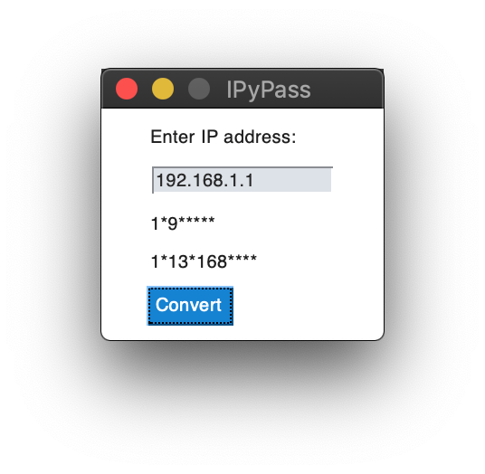

IPyPass :closed_lock_with_key: :unlock:
========================================================================================
|travis| |codacy| |maintained| |python| |mit| |open source|

.. |travis| image:: https://app.travis-ci.com/marshki/IPyPass.svg?branch=master
    :target: https://app.travis-ci.com/marshki/IPyPass
    :alt: Travis

.. |codacy| image:: https://app.codacy.com/project/badge/Grade/bd0bef504604497da04a41b58f09a44e
   :target: https://www.codacy.com/gh/marshki/IPyPass/dashboard?utm_source=github.com&amp;utm_medium=referral&amp;utm_content=marshki/IPyPass&amp;utm_campaign=Badge_Grade
   :alt: Codacy

.. |maintained| image:: https://img.shields.io/badge/Maintained%3F-yes-green.svg
   :target: https://GitHub.com/Naereen/StrapDown.js/graphs/commit-activity
   :alt: Maintained

.. |python| image:: https://img.shields.io/badge/Made%20with-Python-1f425f.svg
   :target: https://www.python.org/
   :alt: Python

.. |mit| image:: https://img.shields.io/badge/License-MIT-blue.svg
   :target: https://lbesson.mit-license.org/
   :alt: MIT

.. |open source| image:: https://badges.frapsoft.com/os/v3/open-source.svg?v=103
   :target: https://github.com/ellerbrock/open-source-badges/
   :alt: Open Source

IP-based password generator
---------------------------
Python3 utility (w/Tkinter) for converting IPv4 IP address to an 8- or 12-character password.
Modify the algo to suit your needs.

Requirements
------------
Python 3.9+. Tkinter is only needed for the GUI.

Install
-------

.. code-block:: bash

    pipx install git+https://github.com/marshki/IPyPass

Usage
-----
From a shell (argument parser):

.. code-block:: bash

    ipypass --ip 192.168.1.1

From a shell (GUI):

.. code-block:: bash

    ipypass

then enter an IPv4 address in the window and click **Convert**. Program will:

* validate address
* split address by '.'
* take 3rd octet and append ``*``
* take 4th octet, add 8 or 12, and append ``*``
* (12-character only) append 2nd octet
* pad with ``*`` so the string is 8 or 12 characters in length

For example:

.. csv-table::
   :header: "IP address", "8-character password", "12-character password"
   :widths: 20, 20, 20

   "10.1.1.1", "1*9*****", "1*13*1******"
   "192.168.1.1", "1*9*****", "1*13*168****"

Without installing, run ``python3 ipypass.py`` from the repo instead of ``ipypass``.

Change Log
----------
CHANGELOG_

.. _CHANGELOG: https://github.com/marshki/IPyPass/blob/master/CHANGELOG.rst

License
-------
LICENSE_

.. _LICENSE: https://github.com/marshki/IPyPass/blob/master/LICENSE
